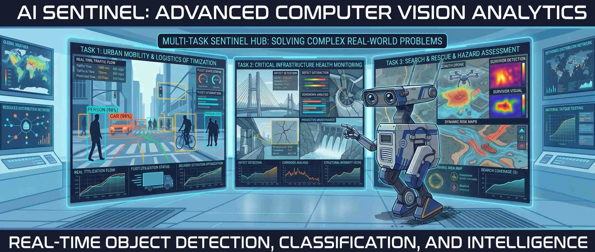

# 🛡️ Sentinel

[](https://results.pre-commit.ci/latest/github/Borda/vision-delivery/main) [](https://borda.github.io/vision-delivery/) [](https://github.com/Borda/vision-delivery/actions/workflows/docs.yml) [](https://github.com/Borda/vision-delivery/actions/workflows/evals.yml) [](https://www.apache.org/licenses/LICENSE-2.0)



**Get a measured first answer to a computer-vision question with no Roboflow account, then keep an independent acceptance check and, on Claude Code, a spend gate beside the official Roboflow plugin.**

`vision-delivery` ships the `sentinel` plugin for Claude Code and Codex. You describe the outcome you need from images or video. Sentinel locks a success target, measures the cheapest baseline first, and gives you an auditable go / revise / stop decision. It complements [Roboflow](https://roboflow.com) and the official [Roboflow skills](https://github.com/roboflow/computer-vision-skills): they own the platform, Sentinel owns the target, the measurement, and the approval before spend.

```text
"Count pallets crossing this line and report the hourly total. I have 60 sample frames.
A missed pallet is worse than a duplicate count."
```

## ⏱️ A first answer in minutes, with no account

The first session runs in **explore mode**. You get plain-language numbers and no proof-chain ceremony.

1. Sentinel reads your files and asks at most three business questions, such as "out of 100 real cases, how many misses are acceptable?".
2. It locks that target before looking at any result.
3. It runs **rung 0** of the [baseline ladder](resources/baseline-ladder.md). The host model looks at your labeled sample images, and [`score_baseline.py`](resources/scripts/score_baseline.py) scores the answers. No Roboflow sign-in, upload to Roboflow, or Roboflow spend is needed; the images go to your host model, like any image you attach to a chat.
4. You get one line, for example: *"Real cases caught: 39 of 40 real cases (98%, 95% interval 87% to 100%); target >= 80%: PASS. Missing predictions: 0."*, plus what to try next. A result too close to the target to call on that sample reads INCONCLUSIVE instead of PASS, and a sample too small or missing predictions gets NO VERDICT.

Only when the result heads for production, a third party, or a paid action does Sentinel switch to **deliver mode**: frozen acceptance files, digest-bound evidence, and validated handoffs. See [delivery modes](resources/delivery-modes.md).

## 💳 Spend protection you can check

On **Claude Code**, Sentinel installs a `PreToolUse` hook ([`hooks/gate.js`](hooks/gate.js)) on every Roboflow MCP tool:

- each call is classified from a policy generated from Roboflow's published tool catalog ([`hooks/gate-policy.json`](hooks/gate-policy.json)). Tools Roboflow marks read-only pass, except two billed ones (`models_infer`, `media_analyze`); a tool the policy does not list is treated as gated;
- every other call is **denied** until a structured action brief is recorded in the project ledger: scope, an upper cost estimate with its source and date, data movement, and rollback;
- with a brief, the call goes to **your host permission prompt**, which shows those fields. The gate never auto-approves. One brief covers one execution. Two single-image tools (`models_infer`, `autolabel_preview`) instead run under one brief with a stated call budget: you approve the budget at the first call, and later calls inside it follow your normal host permission rules;
- in `bypassPermissions` and `dontAsk` modes such calls are denied, because the host shows no prompt there. In `auto` mode the gate returns `ask` for every gated call, including each call inside a budget.

The gate covers Roboflow MCP tool calls only, from a server whose name contains `roboflow`. A Roboflow SDK, CLI, or REST call made from a shell command or a generated script does not pass through it, and neither does the same server registered under another name; [Trust and Safety](https://borda.github.io/vision-delivery/trust/) lists what the gate does not cover.

**Codex is the methodology tier: no gate.** No verified pre-action hook exists there, so Sentinel writes the brief and stops; you execute it yourself. The locked target, the baseline ladder, and the scorer are the same on both hosts (no recorded live run on either host yet). The gate is a guard, not a budget. Keep account budgets and a non-production workspace too.

## 🚀 Install

```bash
# Claude Code: methodology and spend gate
claude plugin marketplace add Borda/vision-delivery
claude plugin install sentinel@sentinel

# Codex: methodology only, no gate
codex plugin marketplace add https://github.com/Borda/vision-delivery
codex plugin add sentinel@sentinel
```

No credential environment variable is needed. Roboflow sign-in uses the host-managed MCP flow the first time a live Roboflow action runs. Never paste credentials into chat or commit them. For plugin development, run `claude plugin validate .` and `claude --plugin-dir .` from a checkout.

## 🎯 Routes

| Status       | Route                                                            | Use it for                                                            | Sentinel scorer                                                                      |
| ------------ | ---------------------------------------------------------------- | --------------------------------------------------------------------- | ------------------------------------------------------------------------------------ |
| **Flagship** | `detect-and-analyze`                                             | counting and finding objects or defects                               | yes: per-image counts (`--task count`)                                               |
| **Flagship** | `classify-or-flag`                                               | one pass/fail or category verdict per image                           | yes: yes/no flags only (`--task flag`); multi-class categories need your own tooling |
| Guided       | `estimate-economics`, `deliver-cv-project`, `decision-report`    | cost, packaging, and the final decision record                        | not a measurement route                                                              |
| Preview      | `track-and-count`, `read-text`, `segment-and-analyze`            | tracking over time, OCR, masks and measurement                        | no Sentinel scorer yet                                                               |
| Preview      | `recognize-pose-or-gesture`, `decompose-to-pipeline`             | keypoints and multi-stage systems                                     | no Sentinel scorer yet                                                               |
| Utility      | `check-sentinel-setup`, `auth-setup`, `status`, `report-outcome` | install check, Roboflow sign-in, project status, outcome-report draft | not a measurement route                                                              |

Flagship routes are the ones being taken to live end-to-end proof on public data first. Preview routes have a full workflow but less evidence, and "no Sentinel scorer yet" means the route defines its metric but you measure it with your own or upstream tooling; use them with more caution. Start with `solve-cv-task` (Claude Code: `/sentinel:solve-cv-task`) when you are unsure which route fits.

## 📋 Honest status

> **v0.5 release candidate.** The v0.5 release candidate passed local clean-home marketplace simulations. Manual public-GitHub marketplace installation was recorded for v0.3 on Codex and Claude Code; the v0.5 public-install path remains unverified.
>
> Evidence is thin, and it is stated in one place. [Support & Evidence](https://borda.github.io/vision-delivery/support-and-scope/) holds every claim with its numbers and limits; read it before relying on any route in production.

Tried it? [Tell us how it went](https://github.com/Borda/vision-delivery/issues/new?template=outcome-report.yml). Outcome reports from real projects are the most useful thing you can send right now.

## 🔁 The delivery loop



Generated scripts, eval files, and ledger rows are workflow outputs, not proof that they are correct or that they ran. Inspect and run them in your own environment before relying on them.

## 🤝 Sentinel and official Roboflow skills

Use both. Sentinel owns the delivery question: *what should we build, what evidence is enough, and what decision follows?* Roboflow owns current product truth: MCP tool semantics, model IDs, Workflows, plans, and pricing. Sentinel reads the installed official Roboflow skills first, then `skill://roboflow/<name>/SKILL.md` MCP resources. When neither is available, it marks platform details unverified. Installing both full plugins can duplicate the `roboflow` MCP server on hosts that do not deduplicate; see [Roboflow Skills Integration](https://borda.github.io/vision-delivery/roboflow-skills/).

## ⚠️ Safety boundary

Before work involving faces, license plates, people tracking, forms, medical imagery, worker monitoring, or other sensitive data, require all of the following:

- documented authority and allowed purpose,
- minimum necessary data and retention rules,
- a representative, bias-aware evaluation set,
- a named human reviewer and appeal/override path,
- legal, privacy, and security review appropriate to the consequences.

Do not use Sentinel as the sole basis for medical, employment, law-enforcement, access-control, or physical-safety decisions. Read [Trust and Safety](https://borda.github.io/vision-delivery/trust/) and the [security policy](https://github.com/Borda/vision-delivery/blob/main/.github/SECURITY.md).

## 📚 Project resources

- [Documentation](https://borda.github.io/vision-delivery/) · [Quick start](https://borda.github.io/vision-delivery/quickstart/) · [Use cases](https://borda.github.io/vision-delivery/use-cases/)
- [First-baseline example](https://github.com/Borda/vision-delivery/tree/main/examples/first-baseline)
- [Support, scope, and evidence](https://borda.github.io/vision-delivery/support-and-scope/) · [Benchmarks](https://borda.github.io/vision-delivery/benchmarks/)
- [Compatibility](https://borda.github.io/vision-delivery/compatibility/) · [Release policy](https://borda.github.io/vision-delivery/release-policy/) · [Changelog](https://github.com/Borda/vision-delivery/blob/main/CHANGELOG.md)
- [Contributing](https://github.com/Borda/vision-delivery/blob/main/.github/CONTRIBUTING.md) · [Support policy](https://github.com/Borda/vision-delivery/blob/main/.github/SUPPORT.md) · [Security](https://github.com/Borda/vision-delivery/blob/main/.github/SECURITY.md)

💡 Found a reproducible bug or have a suggestion? [Open an issue](https://github.com/Borda/vision-delivery/issues/new/choose). Pull requests are limited to four narrow lanes, which are not open yet; see the [contributing guide](https://github.com/Borda/vision-delivery/blob/main/.github/CONTRIBUTING.md). Do not attach secrets, private customer data, faces, license plates, medical data, or media you are not authorized to share.

Released under Apache-2.0. See [CITATION.cff](https://github.com/Borda/vision-delivery/blob/main/CITATION.cff) for citation metadata and [NOTICE](https://github.com/Borda/vision-delivery/blob/main/NOTICE) for redistribution notices.
