# Sentinel

<section class="vd-hero" markdown="1">
  <p class="vd-kicker">Plugin for Claude Code and Codex</p>
  <h2>Get a measured first answer to a computer-vision question with no Roboflow account, then keep an independent acceptance check and, on Claude Code, a spend gate beside the official Roboflow plugin.</h2>
  <p>
    Describe what you need to see, count, read, track, or measure. <strong>Sentinel</strong> locks a success target, measures the cheapest baseline first, and gives you a go, revise, or stop decision.
  </p>
  [Get a first number](quickstart.md){ .md-button .md-button--primary }
  [See sample output](sample-output.md){ .md-button }
</section>

You do not need to know model families, metric names, or Roboflow APIs before starting. You do need authority to use the data, representative examples, the business consequence of errors, and a human who owns the result.

```text
Count pallets crossing this line and report the hourly total. I have 60 sample
frames. A missed pallet is worse than a duplicate count.
```

The expected answer is not a list of models. Sentinel should clarify the output, translate the consequence into a proposed eval, measure a baseline, and recommend the least costly next step.

## A first number with no account

The first session runs in **explore mode** and starts at **rung 0** of the baseline ladder. You label a small set of images (10 or more for a yes/no flag, 20 or more for a count), the host model answers the business question for each one, and a small script scores the answers against a target that was locked first. No Roboflow sign-in, upload to Roboflow, or Roboflow spend is needed; the images go to your host model, like any image you attach to a chat, so the sensitive-data rules below apply from the first image. You get one plain line with the counts behind the number, a 95% interval, and a verdict; it reads `PASS` only when the whole interval meets the target.

Sentinel climbs to an open-vocabulary model, a public model, or fine-tuning only when the lower rung misses the target, and it switches to **deliver mode**, with frozen acceptance files and digest-bound evidence, only when the result heads for production, a third party, or a paid action. [Modes and the baseline ladder](modes-and-ladder.md) explains both.

## What Sentinel owns

<div class="vd-card-grid">
  <article class="vd-card">
    <h3>Business-to-CV translation</h3>
    <p>Turn plain-language outcomes into boxes, labels, text, masks, tracks, keypoints, and measurable decisions.</p>
  </article>
  <article class="vd-card">
    <h3>Evidence before spend</h3>
    <p>Lock the success target, measure the cheapest baseline, and investigate misses before training or deployment. On Claude Code, a spend gate holds each paid action for your approval.</p>
  </article>
  <article class="vd-card">
    <h3>Inspectable handoff</h3>
    <p>Request local eval, script, result, provenance, and economics artifacts that a human can verify.</p>
  </article>
</div>

Sentinel complements the official Roboflow plugin; it does not replace it and does not own current Roboflow product truth. Exact MCP behavior, model IDs, Workflows, platform navigation, plans, and prices should come from installed official [Roboflow skills](https://github.com/roboflow/computer-vision-skills), then exposed `skill://roboflow/<name>/SKILL.md` resources. Read [Roboflow Skills Integration](roboflow-skills.md).

## Support tiers

| Tier                    | Current meaning                                                                                                                                                                 |
| ----------------------- | ------------------------------------------------------------------------------------------------------------------------------------------------------------------------------- |
| **Historical evidence** | Recorded pre-v0.2 routing, synthetic process, and private detection results with disclosed limits; not a current support guarantee.                                             |
| **Guided**              | Structured routes exist for detection, classification, tracking, OCR, segmentation, pose/gesture, pipelines, delivery, and economics; equivalent live evidence does not exist.  |
| **Delegated upstream**  | Use official Roboflow sources for current platform/API/model/plan truth while Sentinel frames and evaluates the delivery decision.                                              |
| **Expert required**     | Regulated or safety-critical use, people surveillance, medical work, physical measurement, production streaming/edge architecture, legal review, and final production sign-off. |

The full route-by-route claim register is in [Support & Evidence](support-and-scope.md).

## Install

=== "Claude Code"

    ```bash
    claude plugin marketplace add Borda/vision-delivery
    claude plugin install sentinel@sentinel
    ```

=== "Codex"

    ```bash
    codex plugin marketplace add https://github.com/Borda/vision-delivery
    codex plugin add sentinel@sentinel
    ```

Each host uses two commands. Claude Code gets the methodology and the spend gate. Codex is the methodology tier: the locked target, the ladder, and the scorer are the same there (no recorded live run on either host yet), but it has no gate. The v0.5 release candidate has passed local clean-home marketplace simulations. Manual public-GitHub marketplace installation was recorded for v0.3; the v0.5 public-install path remains unverified. No credential environment variable is required for plugin installation. When the host or account requires it, using the MCP capability requests hosted authorization; an existing authorized session may need no prompt. For Claude plugin development from a checkout, use `claude plugin validate .` and `claude --plugin-dir .`. Never paste credentials into chat.

## Delivery loop



Generated scripts, IDs, eval files, and ledger rows are not self-validating. Inspect and execute them on a representative fixture, compare observed outputs with the committed gate, and record failures before calling a proof complete.

## Evidence today

Evidence is thin: one historical routing run, a mocked process comparison at one run per cell, one small private detection result, and no novice study. [Support & Evidence](support-and-scope.md) states every claim with its numbers and limits.

## Safety before capability

On Claude Code, a Sentinel `PreToolUse` hook holds each paid, data-moving, or state-changing Roboflow MCP call for a recorded action brief and your approval at the host permission prompt; single-image inference is approved once, as a call budget. Codex has no such gate: Sentinel writes the brief and stops. [Trust and Safety](trust.md#paid-actions) describes the gate and what it does not cover.

For faces, license plates, people tracking, forms, medical imagery, worker monitoring, minors, or location-linked media, stop until authority, purpose, minimization, retention, representative evaluation, named human review, and appropriate legal/security/domain checks exist. Sentinel must not be the sole decision-maker for medical, employment, law-enforcement, access-control, or physical-safety outcomes.

Read [Trust and Safety](trust.md) and the repository [security policy](https://github.com/Borda/vision-delivery/blob/main/.github/SECURITY.md).

## Continue

| Need                                  | Read                                                                                    |
| ------------------------------------- | --------------------------------------------------------------------------------------- |
| Exact first-session commands          | [Quick Start](quickstart.md)                                                            |
| See what the tools print              | [Sample Output](sample-output.md)                                                       |
| Understand modes and the ladder       | [Modes and the baseline ladder](modes-and-ladder.md)                                    |
| Pick the right output route           | [Use Cases](use-cases.md)                                                               |
| Understand the delivery sequence      | [Workflow](workflow.md)                                                                 |
| Check claims and limitations          | [Support & Evidence](support-and-scope.md)                                              |
| Separate Sentinel from platform truth | [Roboflow Skills Integration](roboflow-skills.md)                                       |
| Interpret current proof               | [Benchmarks](benchmarks/index.md)                                                       |
| Get community help                    | [Support policy](https://github.com/Borda/vision-delivery/blob/main/.github/SUPPORT.md) |
